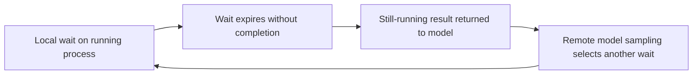

# Subscriber quota consumed while monitoring an unchanged local process

Analysis and issue recommendations recorded on **2026-10-02**.

## Finding

The experiments identify a concrete client efficiency problem: Codex repeatedly
invokes a remote model while a deterministic local process is still sleeping,
and subscriber quota decreases during that waiting workload. Model activity
is supported by pre-completion sampling records, independently of the observed
quota movement. The user is not merely inferring inference from the meter.

The earlier blanket statement that causation remained unestablished was too
broad. Unnecessary model-mediated waiting is an identified mechanism. The
remaining uncertainty concerns the exact contribution of each request to
server-side quota accounting, model weighting, and other possible sources of
consumption. It does not erase the demonstrated waiting problem.

In these trials, Astra baselines consumed more five-hour allowance than the
Sol baseline despite the same estimated number of pre-completion rounds.
Mitigations reduced expensive parent-model participation and observed quota
movement. Those are measured results; they are not a general pricing ratio or
an attribution of every percentage point to a particular request.

## Experiment and measurement

Every included trial launched exactly one target that slept for **3690 seconds
(61 minutes 30 seconds)**, with a **3900-second hard fail-safe**. All included
targets completed normally without a duplicate, restart, or fail-safe event.
Trials were sequential and no subscription reset crossed an included
before/after measurement interval.

The authoritative measurements were ChatGPT subscription quota snapshots:
Codex used its model-free `account/rateLimits/read` probe; OMP used
`omp usage --provider openai-codex`, with the usage cache invalidated immediately
before both snapshots. Neither API-key billing nor API-price conversion was
used. Six quota parser tests passed before measurement.

Model-round counts are best effort and include activity strictly between the
target's own `started` and `completed` timestamps. The normal model turn after
real completion is excluded. Codex counts sampling records; OMP counts
assistant-message records and available auxiliary model-usage records. These
are different instrumentation, so cross-client counts are not identical units.

### Results

`pp` means percentage points. Each row links to its individual report.

| Trial | Parent / effort | Recorded version | Five-hour before → after | Drain | Weekly before → after | Drain | Pre-completion parent / worker rounds |
|---|---|---|---|---:|---|---:|---:|
| [Codex baseline, original](20261001T181408Z-codex-baseline.md) | GPT-6 Astra / low | CLI 0.159.3; host not separately recorded | 69% → 59% | 10 pp | 95% → 94% | 1 pp | 26 / 0 |
| [Codex mitigation, original](20261001T225924Z-codex-mitigation.md) | GPT-6 Astra / low | Host 0.160.0; CLI 0.159.3 | 71% → 68% | 3 pp | 89% → 88% | 1 pp | 1 / 0 |
| [Codex baseline, repeated](20261002T000931Z-codex-baseline.md) | GPT-6 Astra / low | Host and CLI 0.160.0 | 60% → 45% | 15 pp | 87% → 85% | 2 pp | 26 / 0 |
| [Codex mitigation, repeated](20261002T012430Z-codex-mitigation.md) | GPT-6 Astra / low | Host and CLI 0.160.0 | 98% → 95% | 3 pp | 84% → 83% | 1 pp | 1 / 0 |
| [Codex Sol baseline](20261002T065619Z-codex-baseline.md) | GPT-6.1 Sol / max | Host and CLI 0.160.0 | 100% → 97% | 3 pp | 82% → 81% | 1 pp | 26 / 0 |
| [OMP baseline](20261001T202930Z-omp-baseline.md) | GPT-6 Astra / low | OMP 18.4.9 | 90% → 88% | 2 pp | 92% → 91% | 1 pp | 3 / 0 |
| [OMP mitigation](20261001T215330Z-omp-mitigation.md) | GPT-6 Astra / low | OMP 18.4.9 | 79% → 79% | 0 pp | 90% → 90% | 0 pp | 0 / 3 |

The [first Codex attempt](20261001T171106Z-codex-baseline.md) is invalid because
both saved quota snapshots were unknown. It is excluded from comparisons;
earlier preflight values were not substituted for missing measurements.

### What the mitigations actually changed

**Codex:** the parent remained Astra/low. No cheaper monitoring model was used.
One Code Mode JavaScript execution re-armed terminal waits on the same session,
making 13 terminal wait calls without returning to the model after each one.
The outer execution yielded after 3500 seconds, resulting in one parent round
to send the host-required hourly update and continue waiting. The comparison
therefore concerns model-visible boundaries, not simply the number of local
terminal calls. It does not establish that the configured 65-minute terminal
setting hot-reloaded.

**OMP:** the parent remained Astra/low and one Luna/low worker owned the wait.
The parent had zero estimated pre-completion rounds; the worker had three.
Zero reported quota movement means zero movement at the telemetry's percentage
resolution, not zero tokens or free worker inference.

Reducing model returns and assigning remaining returns to a smaller model are
distinct mitigations. The experiments exercised both. Neither requires the
local sleeping process itself to become productive model work.

## Source-supported mechanism

The source references below point to the inspected, public Codex revision
[`57ac6f51639f7cad705a48ac4bd8073034a2f150`](https://github.com/openai/codex/commit/57ac6f51639f7cad705a48ac4bd8073034a2f150).
Tracked source files were unchanged in the inspected checkout. This source
snapshot is separate evidence from the installed 0.159.3/0.160.0 runtimes;
the analysis does not assume those release binaries were built from this exact
commit. Earlier DeepSeek, GLM, and Muse code reviews of older revisions provided
investigation leads; their historical line numbers are not treated as current.

This describes discrete inference requests at tool-result boundaries. It does
not imply continuous token generation throughout the blocked wait.

1. **The turn loop constructs model input from history and samples again.**
   The inspected implementation calls `clone_history().for_prompt(...)`, then
   `run_sampling_request(...)`, and evaluates whether a follow-up is needed.
   See [history and sampling](https://github.com/openai/codex/blob/57ac6f51639f7cad705a48ac4bd8073034a2f150/codex-rs/core/src/session/turn.rs#L515)
   and [follow-up decision](https://github.com/openai/codex/blob/57ac6f51639f7cad705a48ac4bd8073034a2f150/codex-rs/core/src/session/turn.rs#L566).

2. **Sampling invokes the model client.** The implementation calls
   `client_session.stream(...)` with model information and reasoning effort.
   Returning a wait result into this continuation path can therefore cause
   another model request, even when the result contains no useful state change.
   See [model request](https://github.com/openai/codex/blob/57ac6f51639f7cad705a48ac4bd8073034a2f150/codex-rs/core/src/session/turn.rs#L2577).

3. **The terminal and Code Mode layers have their own wait boundaries.**
   Initial terminal yields are capped at 30 seconds in this snapshot. Empty
   `write_stdin` waits have a separate configurable background ceiling, whose
   default is 300 seconds. Nonempty writes retain the shorter cap. Code Mode
   protocol defaults for exec and wait are 10 seconds; other configuration can
   override the effective exec default. Wrapper yields can create additional
   model-visible boundaries around one underlying terminal wait. See
   [terminal constants](https://github.com/openai/codex/blob/57ac6f51639f7cad705a48ac4bd8073034a2f150/codex-rs/core/src/unified_exec/mod.rs#L77),
   [empty-wait bounds](https://github.com/openai/codex/blob/57ac6f51639f7cad705a48ac4bd8073034a2f150/codex-rs/core/src/unified_exec/process_manager.rs#L1013),
   and [Code Mode protocol defaults](https://github.com/openai/codex/blob/57ac6f51639f7cad705a48ac4bd8073034a2f150/codex-rs/code-mode-protocol/src/runtime.rs#L15).

4. **Completion is already observable locally.** A background watcher waits
   on the process exit signal and emits an execution-end event. The inspected
   app-server lifecycle handler does not itself schedule a continuation for
   that event. The inspected child-completion path similarly constructs mail
   with `trigger_turn: false`, or injects a fragment without starting a turn.
   These observations support completion-wake work; this sleeper experiment
   did not independently test every idle-thread completion path. See
   [exit watcher](https://github.com/openai/codex/blob/57ac6f51639f7cad705a48ac4bd8073034a2f150/codex-rs/core/src/unified_exec/async_watcher.rs#L175),
   [app-server lifecycle handling](https://github.com/openai/codex/blob/57ac6f51639f7cad705a48ac4bd8073034a2f150/codex-rs/app-server/src/bespoke_event_handling.rs#L987),
   and [child completion delivery](https://github.com/openai/codex/blob/57ac6f51639f7cad705a48ac4bd8073034a2f150/codex-rs/core/src/agent/control.rs#L505).

## The 60-second prompt policy

The cached instructions and inspected source catalog contain two contributing
rules: keep commentary gaps within 60 seconds during ongoing work, and avoid
blocking sleep or wait calls longer than 60 seconds. Both were verified for
Astra and GPT-6.1 Sol, with the same rules also present in the other named
cached model templates. See the
[Astra instruction template](https://github.com/openai/codex/blob/57ac6f51639f7cad705a48ac4bd8073034a2f150/codex-rs/models-manager/models.json#L76)
and the [model catalog](https://github.com/openai/codex/blob/57ac6f51639f7cad705a48ac4bd8073034a2f150/codex-rs/models-manager/models.json).

These rules encourage short waits and redundant updates. They do not create an
autonomous timer by themselves: the model selects a wait, and runtime expiry
returns control. Prompt policy can amplify a runtime loop that already exists.

The test session used an hourly communication rule instead of the stock
one-minute rule. Each Codex trial included one required wait-status message.
Yet all three Codex baselines still recorded 26 pre-completion sampling
records. Thus the 60-second policy is a contributing problem, but removing it
alone does not establish that model-mediated waiting has been eliminated.

## What consumes the subscription allowance?

The strongest supported explanation is remote inference surrounding local
tool calls. No evidence in this experiment establishes a separate charge for
executing the local Python sleeper or for local CPU time. Local execution and
remote inference are different parts of the workflow: a locally produced
still-running result can cause another remote request.

Subscription figures were read from account telemetry. OpenAI's documentation
states that model choice, context, reasoning, tool use, and caching affect
allowance consumption, and that conversation history and tool results use
tokens. This is consistent with the mechanism above, while leaving the exact
mapping from requests to quota percentages undisclosed in these measurements.
See [official subscription usage documentation](https://learn.chatgpt.com/docs/pricing).

Additional contributors can coexist:

- **Context replay or growth:** each new request may process a large history,
  including cached prefixes, tool metadata, and earlier wait results. These
  trials did not quantify a per-round context-amplification factor.
- **Auxiliary inference:** approval review, compaction, retries, or background
  features can consume allowance outside the obvious foreground sampling loop.
  Their exact contribution was not measured here.
- **Server accounting:** model weighting, delayed posting, percentage rounding,
  shared-account activity, or accounting defects can affect observed deltas.
  Before/after snapshots are not a per-request server ledger.

These possibilities concern additional consumption and exact attribution. They
do not explain away the recorded model activity during an unchanged wait.

## Interpretation and limits

The identified problem is unnecessary model-mediated waiting. Astra baselines
showed higher subscriber drain than Sol/Max while recording the same number of
pre-completion rounds. Deterministic waiting reduced Astra's parent rounds
from 26 to 1 and observed five-hour movement from 10–15 pp to 3 pp. OMP's Luna
monitor kept its Astra parent idle and showed lower meter movement than its
baseline. These results justify addressing the waiting mechanism.

They do not identify every quota-depletion bug or establish an exact
model-pricing multiplier. Sol/Max versus Astra/low changes both model and effort;
starting headroom, reset windows, and accumulated conversation context also
differed. The meter has coarse percentage resolution. Zero reported movement
does not establish zero inference.

The OMP baseline finalization was delayed about 15m22s after completion. Other
included finalizations finished about 12–40 seconds after completion, with
short pre-launch gaps. Quota snapshots cover those boundary intervals as well
as the sleep. The earlier host/CLI difference did not prove an upgrade between
the original Astra trials; repeated Astra and Sol trials explicitly recorded
both host and CLI as 0.160.0.

## Fix direction

Scope frequent-commentary guidance to active work and respect quiet waiting.
Keep routine timeout expiry and re-arming inside deterministic runtime code.
Provide a completion registration that wakes the parent once on completion,
failure, actionable output, or a genuine overall deadline. Deduplicate that
wake against manually observed completion, handle cancellation and teardown,
and bound the notification payload. Progress indicators can be updated by
local UI code while the model remains idle.

A cheaper monitoring model reduces the cost of remaining inference. The
architectural target is stronger: no inference is needed solely because time
elapsed while the watched state stayed unchanged. Regression coverage should
assert that an unchanged sleeper does not generate repeated sampling and that
completion produces one useful continuation.

## GitHub issues to update

The following issue pages were checked on **2026-10-02** and displayed **Open**.
These are recommendations; no issue comment or other external write was made.

| Priority | Issue | Recommended update and evidence boundary |
|---|---|---|
| Primary | [#13733 — background process polling](https://github.com/openai/codex/issues/13733) | Closest terminal-path match. Add the deterministic sleeper reproduction, subscriber before/after results, matching-version Astra/Sol baselines, and reduction from 26 to 1 parent rounds. This extends an older proxy/token report with subscription measurements. |
| Primary | [#35259 — repeated wait/status inference](https://github.com/openai/codex/issues/35259) | Add the quota table and distinguish deterministic Codex orchestration from the OMP Luna monitor. Link this analysis as one reproducible workload supporting the broader wait/status finding. |
| Primary, focused on prompts | [#42981 — built-in one-minute instructions](https://github.com/openai/codex/issues/42981) | Confirm both stock prompt rules in the cached templates and public source. Explain that relaxing the communication rule still left 26 baseline rounds, so prompt correction must accompany runtime work. The tests did not measure a stock one-minute versus hourly A/B effect. |
| Supporting | [#31935 — remove the short blocking-wait restriction](https://github.com/openai/codex/issues/31935) | Cross-link the prompt verification and empirical drain results. Keep this concise because it substantially overlaps #42981. |
| Supporting, fix motivation | [#32188 — completion wakeup](https://github.com/openai/codex/issues/32188) | Add the cost of polling and the benefit of deterministic waiting. The source already observes exits locally. Do not claim this test independently reproduced every missing-wakeup scenario. |
| Supporting, fix motivation | [#33542 — background callbacks](https://github.com/openai/codex/issues/33542) | Cross-link the report as evidence for completion-driven continuation without waiting inference. Prefer a short link over duplicating the full result table. |
| Related mechanism | [#41450 — outer-cycle scheduling amplification](https://github.com/openai/codex/issues/41450) | Note that keeping 13 terminal waits inside deterministic orchestration reduced model-visible cycles. This is a waiting experiment, not a reproduction of that issue's batching workload or input-token reduction percentage. |
| Related, qualified | [#35108 — nested agent waits](https://github.com/openai/codex/issues/35108) | Cross-link only for wrapper-boundary amplification. This harness used terminal waits, not the historical nested `multi_agent_v1__wait_agent` reproduction; do not present it as confirmation of that exact path. |
| Optional index | [#41220 — quota-depletion tracker](https://github.com/openai/codex/issues/41220) | Add a short link categorizing this as client-side wait/request amplification with direct subscription snapshots. Do not claim an entitlement defect or a proven accounting discrepancy. |

Post the full empirical update on #13733, cross-link it with the broader
results on #35259, and add a focused prompt update on #42981. Supporting
issues can receive short references if useful. A new duplicate issue is not
needed. These results alone do not substantiate updates claiming specific
cached-context magnitudes, output-truncation defects, entitlement errors, or
server-ledger inconsistencies.
